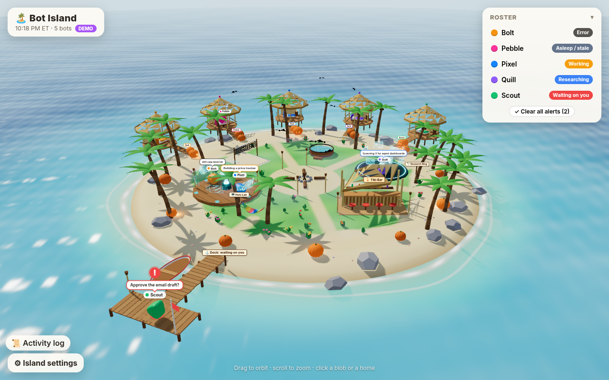
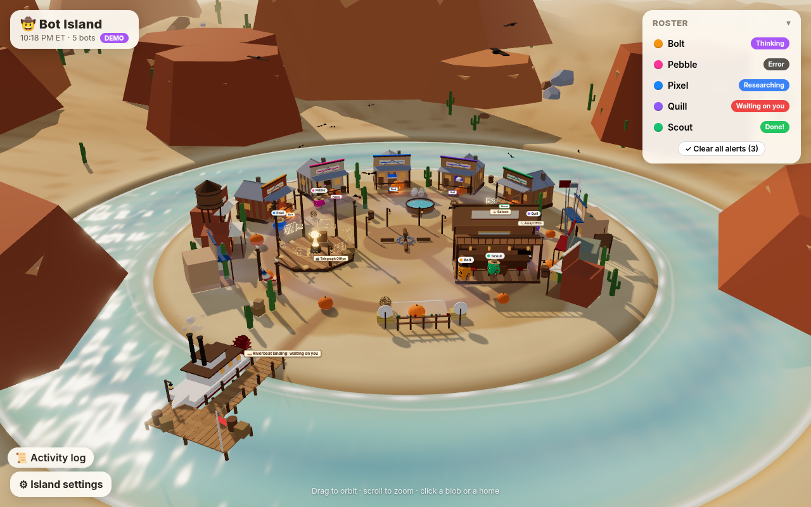
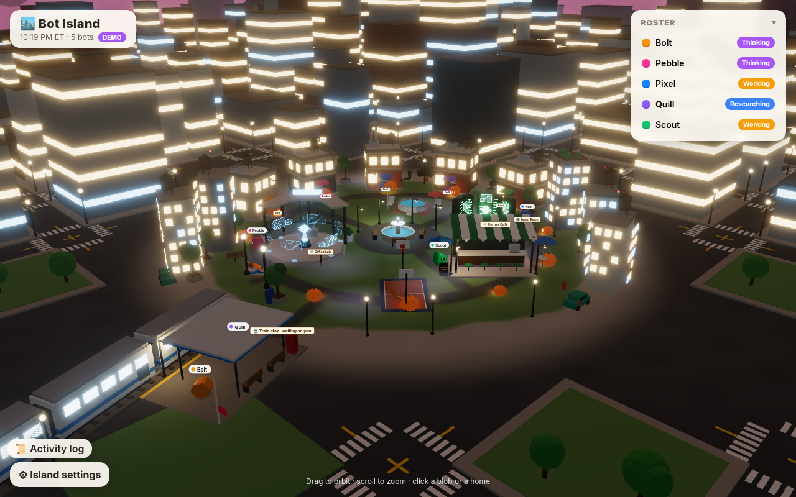
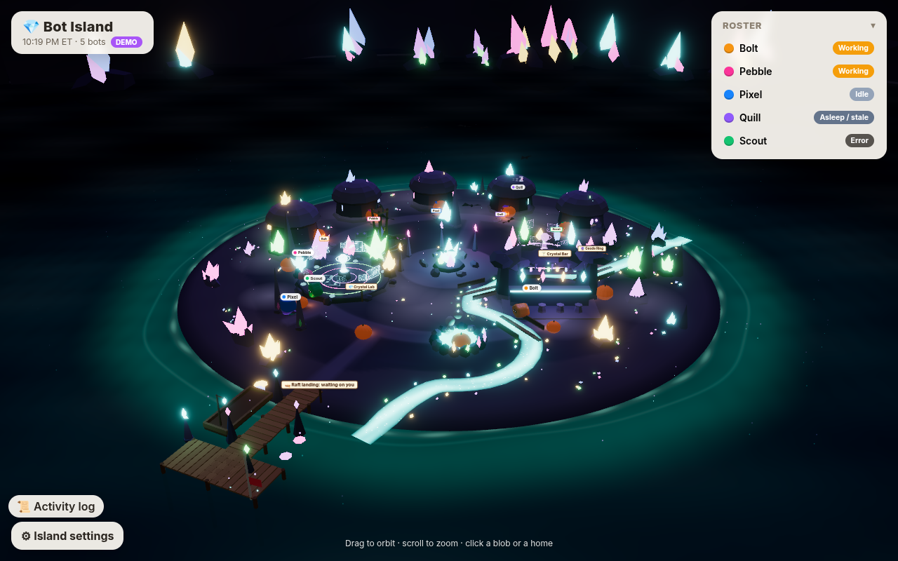
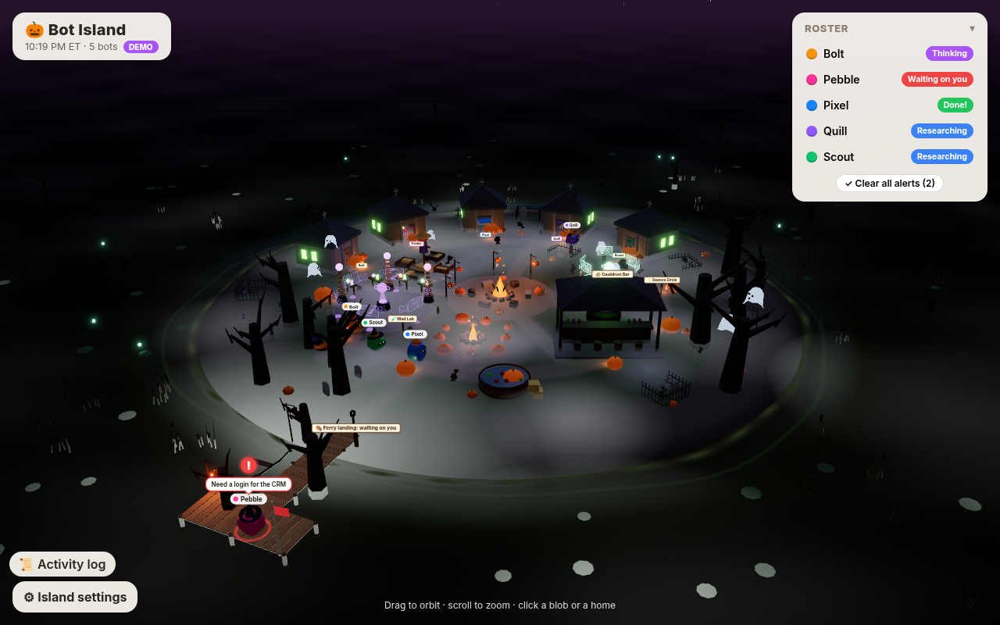
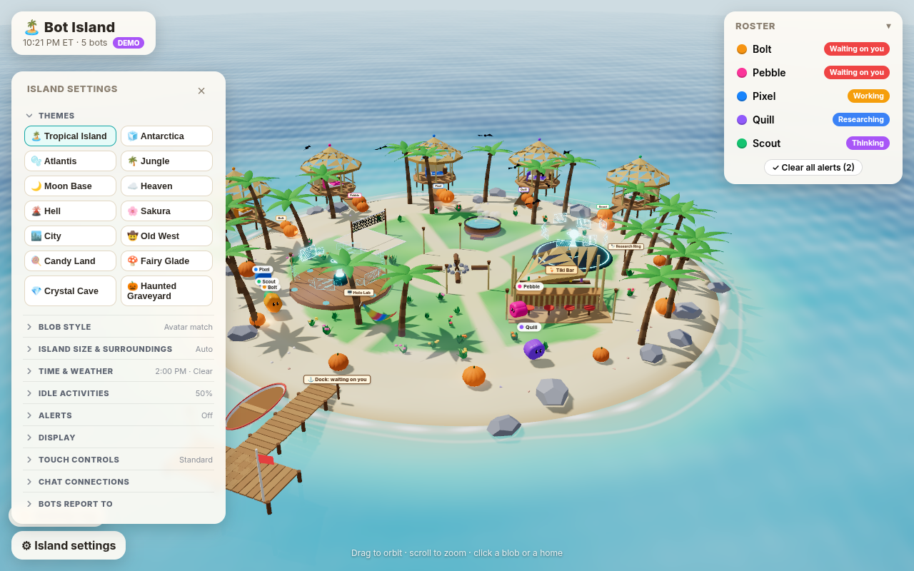

# 🏝️ Bot Island

Watch your AI bots live as little blobs on a 3D island. Each bot has a house; when it's **working** it walks to the
holo lab, when it's **waiting on you** it stands on the dock with a ❗, when it's idle it hangs out in the hot tub,
and when it's asleep it's in bed. Click a blob to see what it's doing and chat with it.

- **Self-hosted, no account.** Every user runs their own island on their own PC or server. There is no central service.
- **Any bot can report.** A bot appends one JSON line per status change (shell, PowerShell, HTTP, or a git repo).
- **14 themes:** Tropical, Antarctica, Atlantis, Jungle, Moon, Heaven, Hell, Sakura, City, Old West, Candy Land,
  Fairy Glade, Crystal Cave and Haunted Graveyard, with day/night, weather, idle activities and per-theme surroundings.
- **Blob styles:** Avatar match (shape + color from each bot's profile), Classic, Gem, Voxel and Jelly.
- **Apps:** browser, Windows desktop app, Android app, and an installable phone web app (PWA).

| | |
|---|---|
|  |  |
|  |  |
|  |  |

## Contents
[Choose where to host](#choose-where-to-host-your-island) · [Phone setup](#connect-from-your-phone) ·
[Good to know](#downsides--good-to-know) · [Quick start](#quick-start) · [Linux server / Proxmox](#linux-server-docker-systemd-proxmox) ·
[Windows](#windows) · [macOS](#macos) · [Configuration](#configuration) · [How bots report](#how-bots-report-status) ·
[Chat](#chat-with-your-bots) · [Phone](#phone-android-app-and-pwa) · [Remote access](#remote-access-and-the-access-key) ·
[Development](#development)

## Choose where to host your island
New here (maybe from a reel)? Your island is a small web server that **you** run. Your bots send it status updates and
you open it from your PC or phone. Pick one of these three options:

| Option | Best for | Needs |
|---|---|---|
| **1. Your own always-on PC** (recommended) | most people | a Windows PC that stays on, free Tailscale account |
| **2. Your Grok Bot's computer** | people without an always-on PC | free Tailscale account |
| **3. Docker / Linux server / Proxmox** | home-lab folks | a server you already run |

**Why Tailscale?** Your Grok Bots run on Grok Bot's cloud computer, not in your house. Tailscale is a free private
network (one sign-in) that lets your bots, PC and phone reach each other without opening ports on your router.

### Option 1 (recommended): your own always-on PC with the Windows app
1. **Install the app:** run `BotIsland-Setup-<version>.exe` from the Releases page. SmartScreen will warn because the
   app isn't code-signed: click *More info → Run anyway*.
2. **Keep it running:** add a Bot Island shortcut to your Startup folder (press `Win+R`, type `shell:startup`,
   drag the shortcut in), and in *Settings → System → Power* set **Sleep** to *Never* when plugged in.
3. **Let other devices in:** create `%APPDATA%\BotIsland\botisland.config.json` containing
   `{ "remote": { "enabled": true } }` and restart the app. It now also listens on port 8797 with an access key,
   which is saved in `%APPDATA%\BotIsland\access-key`.
4. **Install Tailscale** on the PC from <https://tailscale.com/download> and sign in. Then, in a terminal, run
   `tailscale serve --bg 8797`. Your island URL is now `https://<pc-name>.<your-tailnet>.ts.net` (shown by
   `tailscale serve status`).
5. **Install Tailscale on your phone** too and sign in with the same account (see [Connect from your phone](#connect-from-your-phone)).
6. **Connect your bots:** paste this into your Grok Bot, filling in the two placeholders:

   ```text
   Please connect yourself to my Bot Island so you show up on it.
   - Island URL: <your island URL, e.g. https://my-pc.my-tailnet.ts.net>
   - Access key: <your access key>
   Steps:
   1. Install Tailscale on your computer and join my tailnet. Give me the login link to approve.
      (If your computer has no TUN device, run tailscaled in userspace mode with a SOCKS5/HTTP proxy
      and send island requests through it.)
   2. Read <island URL>/agent.txt (send "Authorization: Bearer <access key>") and follow it.
   3. Set up a status-reporting skill/script so that every time your state changes (working, researching,
      thinking, waiting_on_user, error, done, idle) you POST {"bot","state","task","action"} to
      <island URL>/api/ingest/report with the header "Authorization: Bearer <access key>".
   4. Save the URL and key in a private config file (chmod 600), never in a shared repo or chat.
   5. Send one test report and tell me when you appear on the island.
   ```
   Do the same for each bot, or ask one bot to set it up for all of them if they share a computer.

### Option 2: host on your Grok Bot's own computer
No always-on PC needed. Paste this into your Grok Bot:

```text
Please host Bot Island for me on your computer.
1. Clone https://github.com/<owner>/bot-island and run it with the remote endpoint on
   (BOTISLAND_REMOTE=1 npm start), in the background.
2. Add a keep-alive check (e.g. a scheduled job every few minutes) that restarts it if it isn't running.
3. Install Tailscale, join my tailnet (give me the login link), and run `tailscale serve --bg 8797`.
4. Set up status reporting for all my bots to this island (see /agent.txt).
5. Tell me the island URL. Give me the access key privately, and don't post it anywhere else.
```
Downsides:
- **It restarts now and then.** The island is down until the keep-alive check brings it back.
- **It's tied to your Grok Bot account.** If the account ends or the computer is reset, the island and its history go
  with it. Ask your bot to back up its data folder (`~/.botisland`) somewhere you own.

### Option 3 (advanced): Docker, a Linux server, or Proxmox
Use `docker compose up -d --build` or `deploy/install-debian.sh --tailscale`. See
[Linux server (Docker, systemd, Proxmox)](#linux-server-docker-systemd-proxmox) below.

## Connect from your phone
1. Install the **Tailscale** app on your phone and sign in with the same account as your island.
2. Install the Android app: download `BotIsland-android-<version>.apk` from the Releases page and allow
   *Install unknown apps* when asked (details in [Phone](#phone-android-app-and-pwa)). On iPhone, open the island
   in Safari and use *Share → Add to Home Screen*.
3. Open the app and enter your **island URL** and **access key**.

*Planned:* QR-code pairing so you can scan instead of typing.

## Downsides / good to know
- **Tailscale is required on every device** that opens the island (PC, phone, and each bot's computer).
- **The host must stay awake.** If the PC sleeps or turns off, bots can't report and your phone can't connect.
- **The access key is full admin access.** Never show it (or the `?key=` URL) in screenshots, screen recordings or
  reels. If it leaks, delete the `access-key` file and restart to get a new one.
- **The apps aren't code-signed yet.** Windows shows a SmartScreen warning and Android asks you to allow unknown apps.
- *Planned:* an in-app "Update available" notice. For now, update by installing the new release over the old one
  (your data is kept) or with `git pull`.

## Quick start
Needs **Node.js 18+** and git.
```sh
git clone https://github.com/<you>/bot-island.git && cd bot-island
npm install
npm start            # builds the web app on first run, asks where bots report, opens http://127.0.0.1:8787
```
With no bots reporting yet you'll see five **demo** bots (`DEMO` badge); they disappear as soon as a real bot reports.
Data and config live in `~/.botisland` (Windows: `%APPDATA%\BotIsland`).

## Linux server (Docker, systemd, Proxmox)
The server always binds its main port (8787) to `127.0.0.1`. For other devices it opens a second, **key-protected**
port (8797, "remote endpoint"); every request there needs the access key (see [Remote access](#remote-access-and-the-access-key)).

### Option A: Docker / Docker Compose
```sh
docker compose up -d --build
cat data/access-key                     # your access key
# open http://<server-ip>:8797/?key=<access key>
```
`docker-compose.yml` maps a persistent `./data` volume to `/data` (events, chat threads, access key, optional
`botisland.config.json`). The container sets `BOTISLAND_REMOTE_BIND=0.0.0.0` so port 8797 is reachable; the key is
always required on that port. Update with `git pull && docker compose up -d --build`.

### Option B: Proxmox LXC container (Debian 12 / Ubuntu 22.04+), or any Debian/Ubuntu VM
1. In Proxmox: **Create CT** → template `debian-12-standard` → 1 core, 1 GB RAM, 4 GB disk is plenty → start it.
   (Unprivileged is fine. For Tailscale inside an unprivileged LXC, add to `/etc/pve/lxc/<id>.conf` on the host:
   `lxc.cgroup2.devices.allow: c 10:200 rwm` and
   `lxc.mount.entry: /dev/net/tun dev/net/tun none bind,create=file`, then restart the CT.)
2. In the container's console as root:
   ```sh
   apt-get update && apt-get install -y git
   git clone https://github.com/<you>/bot-island.git /root/bot-island
   bash /root/bot-island/deploy/install-debian.sh --tailscale    # or --lan, or no flag (proxy on this host)
   ```
   The script installs Node 20, copies the app to `/opt/botisland`, builds it, creates a `botisland` system user,
   installs and starts the **systemd** unit (`deploy/botisland.service`), and prints the access key.
   - `--tailscale`: installs Tailscale, runs `tailscale up` (log in via the printed link) and `tailscale serve --bg 8797`,
     so the island is at `https://<container-name>.<your-tailnet>.ts.net` with real HTTPS.
   - `--lan`: listens on `0.0.0.0:8797` so LAN devices can use `http://<container-ip>:8797`.
3. Persistent data is in `/var/lib/botisland` (events, chat, `access-key`, `botisland.config.json`). Include the CT in
   Proxmox backups, or bind-mount a host directory there (`mp0: /tank/botisland,mp=/var/lib/botisland`).
4. Manage it: `systemctl status|restart botisland`, logs with `journalctl -u botisland -f`.
   Update: `cd /root/bot-island && git pull && bash deploy/install-debian.sh` (data is kept).

Docker inside an LXC also works (enable *nesting* on the CT), but the native systemd install is simpler.

### Manual systemd install
Copy the repo to `/opt/botisland`, run `npm ci && npx vite build`, create a `botisland` user, then
`cp deploy/botisland.service /etc/systemd/system/ && systemctl enable --now botisland`. Edit the `Environment=` lines
to change the data dir, port or bind address.

## Windows
- **Desktop app (recommended):** run `BotIsland-Setup-<version>.exe` from the Releases page (or
  `BotIsland-Portable-<version>.exe`, no install). Windows SmartScreen may warn because the app isn't code-signed:
  *More info → Run anyway*. It runs the island locally in its own window with a tray icon; data in `%APPDATA%\BotIsland`.
  Build it yourself: `cd desktop && npm ci && npm run dist:win` (cross-builds from Linux with wine).
- **From source:** install Node.js 18+, then double-click `start-botisland.bat`.
- Bots on Windows report with `report.ps1` (see below).

## macOS
Install Node.js 18+ (`brew install node`), then follow [Quick start](#quick-start). To keep it running, use a
LaunchAgent or just `npm start` in a terminal. (`cd desktop && npx electron-builder --mac` builds an unsigned app, untested.)

## Configuration
Order: built-in defaults < config file < environment < command line. The config file is `--config <file>`, else
`$BOTISLAND_CONFIG`, else `<data dir>/botisland.config.json`. Examples: `botisland.config.example.json` (desktop) and
`config/server.config.example.json` (server; copy it to `config/server.config.json`, which is gitignored, and run `./start.sh`).

| Setting / env | Meaning |
|---|---|
| `BOTISLAND_HOME` | data dir (default `~/.botisland`) |
| `port` / `BOTISLAND_PORT` | local port, always on 127.0.0.1 (default 8787) |
| `remote.enabled` / `BOTISLAND_REMOTE=1` | open the key-protected remote endpoint |
| `remote.port` / `BOTISLAND_REMOTE_PORT` | remote port (default 8797) |
| `remote.bind` / `BOTISLAND_REMOTE_BIND` | remote bind address (default 127.0.0.1; `0.0.0.0` for LAN/Docker) |
| `remote.keyFile` / `BOTISLAND_KEY_FILE` | access key file (generated on first start) |
| `eventsDir` / `BOTISLAND_EVENTS_DIR` | local folder bots write to |
| `sources` | list of `folder` and `git` sources (see `docs/DEVELOPMENT.md`) |
| `agentsDir` / `BOTISLAND_AGENTS_DIR` | optional bot profiles (`<id>/profile.json` with `name`, `avatarShape`, `avatarColor`) |
| `chatDir`, `chatWebhooksFile` | chat threads and the (secret, chmod 600) webhook file |
| `demo` / `BOTISLAND_DEMO` | `auto` (default), `on`, `off` |
| `staleMinutes`, `doneMinutes` | when a silent bot falls asleep / how long "done" celebrates |

Most of this can also be changed in the app under **⚙ Island settings → Bots report to**.

## How bots report status
Every bot appends one JSON line per change to `<events folder>/<bot>.jsonl`:
```json
{"ts":"2026-10-09T13:05:00-04:00","bot":"Nova","state":"working","task":"Drafting the weekly report","action":"Opened the sales sheet"}
```
States: `working`, `researching`, `thinking`, `waiting_on_user`, `error`, `done`, `idle`. The full spec for bots is
**[AGENT_REPORTING.md](AGENT_REPORTING.md)**, also served by every island at **`/agent.txt`**, so you can tell a bot
"read `<island url>/agent.txt` and report your status there".
- **Same machine:** `./report.sh "Nova" working "Drafting the report"` (Windows: `report.ps1`).
- **Other machines, shared folder:** point a `folder` source at a Syncthing/Dropbox folder.
- **Other machines, shared git repo:** bots push with `report-git.sh` to a private repo you own; the island pulls it
  every ~15 s (`git` source; in the app: Settings → Shared git repo, with an optional read-only token). This is how the
  Windows app and any island that can't be reached directly get status from bots running elsewhere.

## Chat with your bots
Click a bot → type a message. The island POSTs `{"source":"bot-island","bot","messageId","text","ts"}` to that bot's
webhook; the bot answers with `reply.sh <bot> <messageId> "text"` (or `reply-git.sh` via the git repo).
Connect a bot either in **Island settings → Chat connections** (paste webhook URL + key), or let the bot register
itself: **Copy setup** gives a snippet that runs
`WEBHOOK_URL=… WEBHOOK_KEY=… ISLAND_URL=<island url> BOTISLAND_KEY=<access key> ./register.sh <bot>`.
Webhook URLs and keys are stored only in the webhooks file (chmod 600) and never sent to the browser.

## Phone: Android app and PWA
**Android app (APK).** A small Capacitor app that opens *your* island full screen.
1. Download `BotIsland-android-<version>.apk` to the phone (Releases page, or copy it over).
2. Open it; allow *Install unknown apps* for your browser/file manager when asked; tap **Install**
   (Play Protect may warn about an unknown developer: *More details → Install anyway*).
3. On first launch enter the **island URL** (e.g. `https://island.<tailnet>.ts.net` or `http://192.168.1.20:8797`)
   and the **access key**. It's remembered; press **Back** on the island to return to the setup screen to change it.
Plain `http://` on a LAN or Tailscale IP is allowed. Build it yourself:
`cd android-app && npm ci && npx cap sync android && cd android && ./gradlew assembleDebug` (JDK 21 + Android SDK 35).

**PWA:** open the island in Chrome on the phone → ⋮ → *Add to Home screen* / *Install app*.

## Remote access and the access key
The access key is in `<data dir>/access-key` (Docker: `data/access-key`; LXC: `/var/lib/botisland/access-key`).
Open `<url>/?key=<key>` once; the browser keeps a cookie. Bots and scripts send `Authorization: Bearer <key>`.
Keep the key secret; anyone with it can see your island and chat with your bots. Delete the file and restart to rotate it.
- **Tailscale (recommended):** on the island machine `tailscale serve --bg 8797` → `https://<host>.<tailnet>.ts.net`,
  reachable only by your devices. Free for personal use.
- **Reverse proxy** (Caddy, nginx, Traefik, Nginx Proxy Manager) with HTTPS in front of `127.0.0.1:8797`. WebSockets
  (`/ws`) must be proxied. Caddy example: `island.example.com { reverse_proxy 127.0.0.1:8797 }`.
- **LAN only:** `BOTISLAND_REMOTE_BIND=0.0.0.0` and use `http://<ip>:8797`.
- **Cloudflare quick tunnel:** `./start.sh --tunnel` (needs `cloudflared`; URL changes on restart).

## Development
`npm run dev` (Vite), `npm run build`, `node server.js`. Architecture, themes, URL parameters, idle activities and test
tools are in **[docs/DEVELOPMENT.md](docs/DEVELOPMENT.md)**.

## License
[MIT](LICENSE) © Bot Island contributors. Earth textures: NASA Visible Earth (public domain), see docs/DEVELOPMENT.md.
